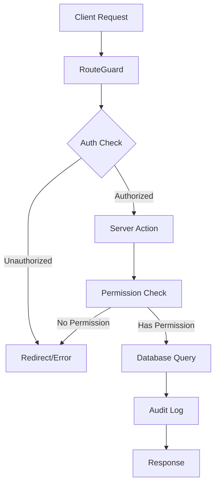

# Finance & RBAC Implementation Guide

The RenkFlow Finance and RBAC (Role-Based Access Control) module provides enterprise-grade financial management with granular permission controls.

## Quick Start

```bash
# Install dependencies
npm install

# Run migrations
npm run db:migrate

# Start development server
npm run dev
```

---

## Architecture Overview



---

## Permission Matrix

### Roles & Permissions

| Permission | Owner | Admin | Accountant | Office | Member | Worker |
|------------|:-----:|:-----:|:----------:|:------:|:------:|:------:|
| **Orders** |
| orders.view | ✅ | ✅ | ✅ | ✅ | ✅ | ✅ |
| orders.edit | ✅ | ✅ | ❌ | ✅ | ✅ | ❌ |
| orders.create | ✅ | ✅ | ❌ | ✅ | ❌ | ❌ |
| orders.delete | ✅ | ✅ | ❌ | ❌ | ❌ | ❌ |
| **Finance** |
| finance.view | ✅ | ✅ | ✅ | ❌ | ❌ | ❌ |
| finance.payments.* | ✅ | ✅ | ✅¹ | ❌ | ❌ | ❌ |
| finance.documents.* | ✅ | ✅ | ✅¹ | ❌ | ❌ | ❌ |
| finance.employees.* | ✅ | ✅ | ✅² | ❌ | ❌ | ❌ |
| **Settings** |
| settings.view | ✅ | ✅ | ❌ | ❌ | ❌ | ❌ |
| settings.edit | ✅ | ✅ | ❌ | ❌ | ❌ | ❌ |
| team.manage | ✅ | ✅ | ❌ | ❌ | ❌ | ❌ |

> ¹ Accountant can create but not delete  
> ² Accountant can edit but not delete

---

## Database Schema

### Finance Tables

```sql
-- Payments: Order revenue tracking
CREATE TABLE payments (
  id uuid PRIMARY KEY,
  tenant_id uuid REFERENCES tenants(id),
  order_id uuid REFERENCES orders(id),
  amount numeric(12,2) NOT NULL,
  currency text DEFAULT 'TRY',
  method text, -- cash, bank_transfer, card, other
  paid_at timestamp,
  note text,
  created_by uuid,
  created_at timestamp
);

-- Order Documents: Invoices, receipts, contracts
CREATE TABLE order_documents (
  id uuid PRIMARY KEY,
  tenant_id uuid REFERENCES tenants(id),
  order_id uuid REFERENCES orders(id),
  type text, -- invoice, delivery_note, receipt, contract, other
  file_name text,
  file_url text,
  mime_type text,
  size_bytes integer,
  uploaded_by uuid,
  uploaded_at timestamp
);

-- Employees: Payroll management
CREATE TABLE employees (
  id uuid PRIMARY KEY,
  tenant_id uuid REFERENCES tenants(id),
  full_name text NOT NULL,
  title text,
  email text,
  phone text,
  active boolean DEFAULT true,
  created_at timestamp,
  updated_at timestamp
);

-- Employee Ledger: Salary, advances, deductions
CREATE TABLE employee_ledger_entries (
  id uuid PRIMARY KEY,
  tenant_id uuid REFERENCES tenants(id),
  employee_id uuid REFERENCES employees(id),
  kind text, -- salary, advance, deduction, payment
  amount numeric(12,2) NOT NULL,
  currency text DEFAULT 'TRY',
  entry_date date,
  note text,
  created_by uuid,
  created_at timestamp
);

-- Audit Logs: Complete audit trail
CREATE TABLE audit_logs (
  id uuid PRIMARY KEY,
  tenant_id uuid,
  user_id uuid,
  user_email text,
  user_role text,
  action text,
  entity_type text,
  entity_id uuid,
  old_values jsonb,
  new_values jsonb,
  ip_address inet,
  user_agent text,
  request_id text,
  metadata jsonb,
  created_at timestamp
);
```

---

## Audit Log Structure

Every financial action is logged with:

| Field | Description |
|-------|-------------|
| `action` | e.g., `payment.create`, `document.delete` |
| `entity_type` | `payment`, `order_document`, `employee`, `employee_ledger_entry` |
| `entity_id` | UUID of affected entity |
| `old_values` | Previous state (for updates/deletes) |
| `new_values` | New state (for creates/updates) |
| `ip_address` | Client IP address |
| `user_agent` | Browser/client info |
| `request_id` | Unique request identifier |

### Audit Actions

```typescript
type AuditAction =
  | 'payment.create' | 'payment.update' | 'payment.delete' | 'payment.batch_delete'
  | 'document.upload' | 'document.delete' | 'document.batch_delete'
  | 'employee.create' | 'employee.update' | 'employee.delete' | 'employee.batch_update'
  | 'ledger.create' | 'ledger.update' | 'ledger.delete'
  | 'export.payments' | 'export.documents' | 'export.employees' | 'export.ledger'
  | 'auth.login' | 'auth.logout' | 'auth.permission_denied';
```

---

## Key Files

| Component | File Path |
|-----------|-----------|
| **Permissions** | `lib/auth/permissions.ts` |
| **RBAC System** | `lib/auth/rbac.ts` |
| **Data Sanitizer** | `lib/auth/sanitizer.ts` |
| **Route Guard** | `components/auth/RouteGuard.tsx` |
| **Finance Types** | `lib/types/finance.ts` |
| **Export Helpers** | `lib/utils/exportHelpers.ts` |
| **Audit Service** | `lib/services/auditLog.service.ts` |
| **Batch Actions** | `app/actions/finance.batch.actions.ts` |

---

## Usage Examples

### Check Permission

```typescript
import { hasPermission } from '@/lib/auth/permissions';

if (hasPermission(user.role, 'finance.payments.create')) {
  // Allow payment creation
}
```

### Require Permission in Server Action

```typescript
import { getServerUserContext, requirePermission } from '@/lib/auth/serverAuth';

export async function createPayment(data: CreatePaymentInput) {
  const context = await getServerUserContext();
  requirePermission(context, 'finance.payments.create');
  
  // Create payment...
}
```

### Sanitize Data for Worker Role

```typescript
import { sanitizeOrderForRole } from '@/lib/auth/sanitizer';

const order = await getOrder(orderId);
const safeOrder = sanitizeOrderForRole(order, user.role);
// Workers won't see totalAmount or currency
```

### Log Audit Event

```typescript
import { AuditLogService } from '@/lib/services/auditLog.service';

await AuditLogService.log({
  tenantId: context.tenantId,
  userId: context.userId,
  userEmail: context.email,
  userRole: context.role,
  action: 'payment.create',
  entityType: 'payment',
  entityId: newPayment.id,
  newValues: { amount, method, orderId },
});
```

---

## Testing

```bash
# Unit tests
npm test

# E2E tests
npm run test:e2e

# Type checking
npm run type-check
```

### Test Coverage

- ✅ Permission functions (`hasPermission`, `hasAnyPermission`, etc.)
- ✅ Role hierarchy (`isRoleAtLeast`)
- ✅ Route access (`canAccessRoute`)
- ✅ Data sanitization (`sanitizeOrderForRole`)
- ✅ Finance role checks (`canAccessFinance`)

---

## Environment Variables

```env
# Database
DATABASE_URL=postgres://...

# Auth
NEXTAUTH_SECRET=...
NEXTAUTH_URL=https://...

# Storage (for documents)
R2_ACCESS_KEY_ID=...
R2_SECRET_ACCESS_KEY=...
R2_BUCKET_NAME=...
R2_ENDPOINT=...
R2_PUBLIC_URL=...
```

---

## Security Features

1. **Row Level Security (RLS)**: All tables enforce tenant isolation
2. **Permission Checks**: Every action validates user permissions
3. **Audit Trail**: Complete logging with IP/User-Agent
4. **Transaction Safety**: Batch operations use database transactions
5. **Input Validation**: Zod schemas for all inputs
6. **Data Sanitization**: Sensitive fields hidden from unauthorized roles
